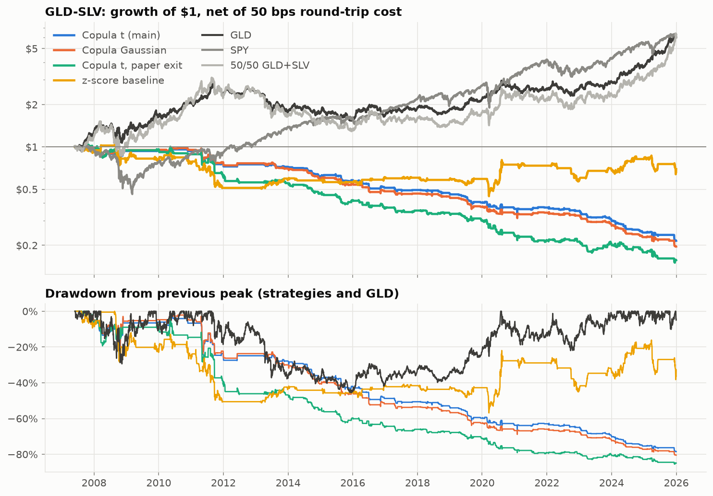

# Copula-Based Pairs Trading: Gold vs Silver

Backtest of a copula-based statistical arbitrage strategy on GLD/SLV, adapting the
framework of Krauss & Stübinger (2015), *Nonlinear dependence modeling with bivariate
copulas: Statistical arbitrage pairs trading on the S&P 100* (IWQW Discussion Paper 15/2015),
with three robustness pairs (GDX/GDXJ, XOM/CVX, KO/PEP).

> Research project for educational purposes only. Not investment advice.
> Historical backtests do not guarantee future results.

## Findings (2007–2025, daily data)

Full analysis, tables and figures: [`notebooks/analysis.ipynb`](notebooks/analysis.ipynb).

- **Tail dependence is real.** Both legs land in their own 5% tail on 2.2–3.8% of days,
  vs 0.25% under independence. Evidence that joint crashes outnumber joint rallies is weak
  (three of four pairs in sample, two of four out of sample).
- **The t-copula fits better than the Gaussian copula**, out of sample, in all four pairs
  (monthly out-of-sample log-likelihood gain, Newey-West p ≤ 0.03). Its advantage in predicting
  how often both legs crash together is not consistent once marginal drift is removed.
- **The better fit does not make the strategy profitable.** Before costs no copula
  specification's mean return differs significantly from zero; after a 50 bps round-trip cost,
  11 of 12 copula runs are significantly negative (net Sharpe −0.41 to −1.82). A z-score spread
  baseline is roughly flat; buy-and-hold GLD returned about 10% a year.
- **Losses are not a crisis effect.** The main copula spec loses in 18 of 19 pair × stress-period
  cells (2007–09, 2011, 2020, 2022), but most of its loss accrues outside those periods. Tail
  dependence peaks in the 2020 COVID shock in all four pairs.
- **Why:** signals come from single-day returns, so 95% of main-spec trades close on the
  reversion rule after ~2 days; the average trade earns less than the cost of making it.
- Strategy returns are on $1 of NAV at 200% gross exposure ($1 long + $1 short, the paper's
  convention); a 100% version roughly halves returns and drawdowns without changing conclusions.
- These results **do not replicate** the paper's positive returns; the study differs in assets,
  period (mostly post-publication) and pair selection, and none of those explanations is tested here.



## Dashboard (Tableau Public)

Link: *to be added after publishing.*

`python -m scripts.export_tableau` writes Tableau-ready CSV files to `exports/tableau/` (field
definitions in [`docs/tableau_data_dictionary.md`](docs/tableau_data_dictionary.md)); the
dashboard is built in Tableau Public following [`docs/tableau_guide.md`](docs/tableau_guide.md).
Buy-and-hold benchmarks are exported as monthly returns only, since Tableau Public data is public.

## Paper vs. this project

| Paper (cited) | My implementation | My extension |
|---|---|---|
| t-copula, semiparametric fit, conditional-probability signals (α = 5%) | Same signal rule applied to pre-selected pairs (GLD/SLV + robustness pairs) | Gaussian vs t-copula comparison (AIC, out-of-sample log-likelihood, tail calibration) |
| S&P 100, 1990–2014, copula-based pair selection | Free data (yfinance), 2006–2025, no pair selection, monthly walk-forward refit | z-score spread baseline |
| Quantile take-profit / stop-loss exit | Implemented as a second, pre-registered specification | Probability-reversion exit as main specification |
| 50 bps round-trip cost, one-day waiting rule | Same, as main specification | Cost sensitivity, break-even cost, Newey-West tests, block-bootstrap Sharpe intervals |

## Setup

Keep the project and the virtualenv outside iCloud-synced folders: iCloud can evict files
to the cloud when disk space is low, which makes Python and SQLite hang.

```bash
python3.12 -m venv ~/.venvs/copula-pairs-trading
source ~/.venvs/copula-pairs-trading/bin/activate
pip install -r requirements-lock.txt   # exact versions behind the results (ranges: requirements.txt)
python -m scripts.init_db
python -m scripts.download_data       # also compares the download with data/manifest.json
python -m scripts.verify_data         # re-check the local database against the manifest
python -m scripts.run_experiments   # all specs x pairs x costs -> SQLite result tables
python -m scripts.export_tableau    # CSV files for the Tableau dashboard
pytest
jupyter lab notebooks/analysis.ipynb
```

## Layout

- `config.yaml` — all parameters; main and second specification registered before results
- `sql/schema.sql` — SQLite schema (prices, risk-free rate, runs, metrics, returns, trades, copula fits)
- `cpt/` — library: `copula`, `signals`, `backtest`, `metrics`, `analysis`, `inference`, `plots`, `data`, `db`, `manifest`
- `scripts/` — `download_data`, `verify_data`, `run_experiments`
- `data/manifest.json` — row counts, date ranges and checksums of the data behind the results (prices are not committed)
- `tests/` — unit tests, including look-ahead, cost-accounting, exposure, drawdown, optimizer and manifest checks
- `scripts/export_tableau.py` — CSV export for the Tableau dashboard (loaders in `cpt/results.py`)
- `docs/` — Tableau build guide and data dictionary
- `notebooks/analysis.ipynb` — dependence analysis, results, significance, subperiods, observations
- `reports/figures/` — figures used in the notebook

## Limitations

- One price path per pair and four pairs chosen ex ante; p-values not adjusted for multiple testing.
- Close-to-close execution, no slippage model; short-selling assumed available with no borrow fee.
- Out-of-sample margins drift (tail shares above 5%); the drift-corrected tail check is a diagnostic only.
- The paper's quantile exit occasionally yields a stop-loss ≥ 0 or take-profit ≤ 0 (25 of 637
  trades); kept as specified rather than patched after seeing results.
- t-copula ν is bounded to [2.01, 200]; 74 of 850 monthly fits sit on a bound (results shown with and without them).
- Free data: yfinance adjusted prices can be revised; `scripts/verify_data` reports any difference from the manifest.
